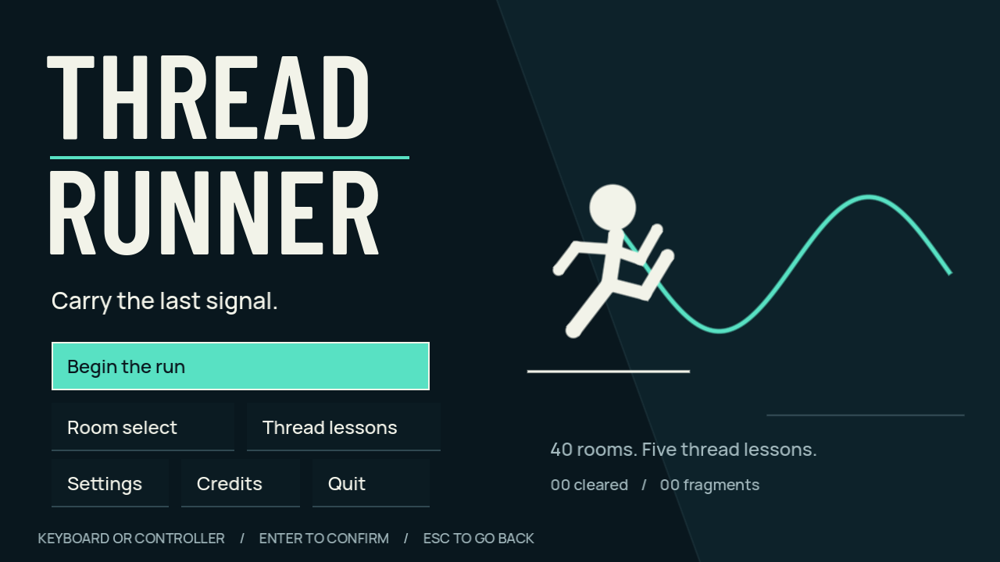
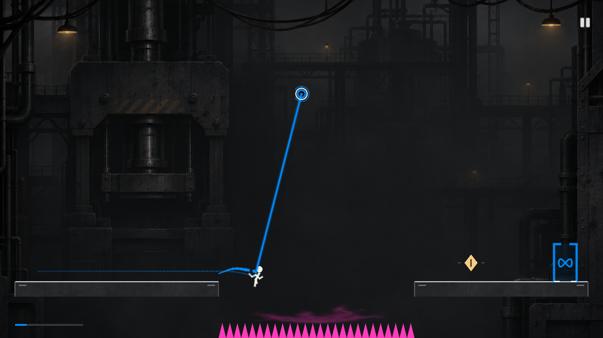

# Threadrunner

Carry the last signal. An original precision platformer with 40 campaign rooms and five Threadwork lessons: stitch bridges, power relays, swing from anchors, and rewind along the thread you leave behind.

## Play in your browser

**[Play Threadrunner — no download needed](https://alexhili-stack.github.io/threadrunner/)**

Click **Play in browser**, then choose **Begin the run** or **Thread lessons**. Keyboard, controller and touch controls are available. Use the player's Fullscreen button for a larger view. Progress saves in the same browser on the same device; clearing site data removes it. The first load is approximately 42 MB and requires WebGL 2.

Send friends the play link above. They do not need Godot, an installation or a GitHub account. Browser build and deployment instructions are in [Browser build](docs/web_build.md).

The browser edition adds thumb-friendly touch groups, live tool availability and lesson objectives. Reachable stitch terminals are outlined, prompts follow your bindings, and spent rewind returns to normal movement until you release it and lay a fresh trail.

## Windows download

**[Download Threadrunner for Windows x64](https://github.com/alexhili-stack/threadrunner/releases/latest/download/Threadrunner-Windows.zip)**

1. Download `Threadrunner-Windows.zip` from [Releases](https://github.com/alexhili-stack/threadrunner/releases).
2. Right-click the ZIP and choose **Extract All**.
3. Open the extracted `Threadrunner` folder and run **Threadrunner.exe**. Keep `Threadrunner.pck` and `third_party` alongside it.

No Godot editor, Python, installation or GitHub account is needed to play. Choose **Thread lessons** from the main menu to learn the tools. The green **Code → Download ZIP** button contains source code; use the Windows release asset to play.

For offline play, send the complete Windows ZIP. Sending just the EXE leaves out the game data. Windows progress saves locally and is separate from browser progress.

## Controls

| Action | Keyboard | Controller |
|---|---|---|
| Move | A / D or arrows | Left stick / D-pad |
| Jump / release grapple upward | Space / Up | A |
| Stitch bridge / power relays | E | X |
| Grapple / release | F | B |
| Rewind laid trail | Hold Shift | Hold LB |
| Retry | R | Y |
| Pause / back | Esc | Start / B in menus |

F11 toggles fullscreen in Windows; the browser player has a Fullscreen button. Settings include keyboard remapping, stick deadzone, separate audio levels and reduced decorative effects. Rewind follows up to six seconds of your real trail; time and hazards continue. Gold fragments count when you finish the same attempt.

## Source and development

Built with **Godot 4.7.2**, GdUnit4 6.2.2 and gdtoolkit 4.5.0. Open `project.godot` with the pinned engine. Development add-ons and license notices are included; downloaded engines, Python environments, generated imports, build binaries, test saves and private source documents are excluded from Git.

Project-local setup and export: [Build and run](docs/build_and_run.md). Run `.venv/Scripts/python.exe tools/qa.py --ui --soak --export` for the full Windows checks. Setup tools are in `tools/install_tools.py` and `tools/install_export_template.py`. Authoring scripts can replace level data; read them before rerunning.

See [thread mechanics](docs/thread_tool.md), [architecture](docs/architecture.md), [design research](docs/visual_research.md) and [verified QA results](docs/public_qa.md).

## Status and credits

The browser edition exports the shared game with Godot 4.7.2. Version 1.2.0 remains available as a standalone Windows x64 release. Native macOS, Linux and Steam Deck builds are not provided. See [verified QA results](docs/public_qa.md) for executed checks and their limits. Human difficulty, physical-controller feel and listening remain playtest tasks.

Design and implementation: Alexander Hili with Codex. Original vector art and synthesized audio. Barlow Condensed and Manrope fonts use SIL OFL 1.1. Godot, GdUnit4 and gdtoolkit retain their own licenses in `third_party`. The project's original code/assets do not yet have a separately specified open-source license.
